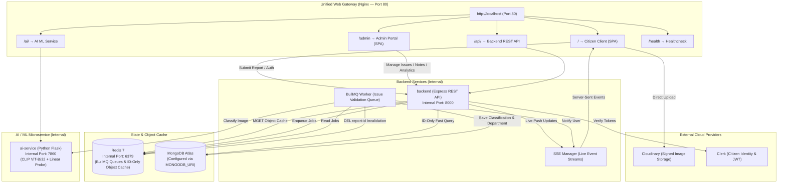

# CivicConnect 🛠️

**CivicConnect** is an enterprise-grade civic issue reporting, automated verification, and municipal management platform. It combines computer vision AI (CLIP + Linear Probe classifier), asynchronous queue processing via BullMQ & Redis, MongoDB persistence, and dedicated web portals for citizens and municipal administrators behind a unified Nginx gateway.

---

## 🏛️ System Architecture



---

## ✨ Key Features

- **Automated AI Issue Classification**: 12 civic categories (Potholes, Garbage, Construction Road, Broken Signage, Bad Streetlight, Bad Billboard, Graffiti, Faded Signage, Sand on Road, Clutter Sidewalk, Unkept Facade, Others) classified in seconds via OpenAI CLIP embeddings and a Linear Probe classifier.
- **Server-Sent Events (SSE)**: Instant real-time updates pushed from backend workers to citizen dashboards without client polling loops.
- **High-Performance Object Caching**: Index-only MongoDB ID scans paired with Redis `MGET` object caching and $O(1)$ single-key invalidation (`DEL report:${id}`).
- **Direct Cloudinary Uploads**: Secure client-side uploads with backend-signed signatures for high-speed image processing.
- **Citizen Portal**: Built with React 19, Tailwind CSS, Clerk authentication, interactive Leaflet maps, and real-time status tracking.
- **Municipal Admin Dashboard**: Live reporting statistics, status & department management, admin notes synced with citizens, interactive cluster map view, and CSV/Excel data export.
- **Unified Production Gateway**: Single Nginx entry point on Port 80 with HTTP security headers (`nosniff`, `SAMEORIGIN`, `strict-origin-when-cross-origin`) and hidden server version tokens.

---

## 📁 Repository Structure

```
CivicConnect/
├── docker-compose.yml       # Production Docker Compose stack
├── Dockerfile               # Multi-stage Dockerfile: builds Client & Admin SPAs into Nginx
├── nginx.conf               # Unified Nginx reverse proxy configuration
├── .env.example             # Centralized environment template (The single source of truth)
├── .env                     # Local environment file (Git-ignored)
├── .gitignore               # Monorepo git exclusion rules
├── .dockerignore            # Monorepo Docker build exclusion rules
│
├── backend/                 # Node.js Express REST API & BullMQ Queue Worker
│   ├── src/
│   │   ├── controllers/     # User and admin route handlers
│   │   ├── middlewares/     # JWT authentication, multer, error handling
│   │   ├── models/          # MongoDB Mongoose schemas (Report, User, Admin, Counter)
│   │   ├── queues/          # BullMQ queue worker and ML classification processor
│   │   ├── routes/          # Express route definitions
│   │   └── utils/           # SSE manager, Redis client, Cloudinary helper
│   ├── scripts/             # Database seeding and counter maintenance scripts
│   ├── Dockerfile           # Node.js 20 Alpine container
│   └── package.json
│
├── ai-service/              # Python Flask ML microservice
│   ├── app.py               # Flask application server & /predict endpoint
│   ├── ml/                  # Feature extractor & trained model weights
│   ├── Dockerfile           # Python 3.12 container
│   └── requirements.txt
│
├── client/                  # Citizen Web Application (React 19 + Vite)
│   ├── src/                 # Pages (ReportIssue, MyComplaintsTable, Dashboard, Leaderboard)
│   ├── Dockerfile
│   └── package.json
│
└── admin/                   # Municipal Admin Dashboard (React 19 + Vite)
    ├── src/                 # Pages (AdminDashboard, AdminReports, AdminMapView, AdminAnalytics)
    ├── Dockerfile
    └── package.json
```

---

## 🚀 Quick Start (Docker)

All services run seamlessly in Docker with **zero local host dependencies** (no local Node.js, Python, or Redis required).

### 1. Configure Environment
Copy the environment template and fill in your credentials:
```bash
cp .env.example .env
```

Edit `.env` with your actual keys:
- `MONGODB_URI`: Your MongoDB Atlas connection URL
- `CLERK_SECRET_KEY` & `VITE_CLERK_PUBLISHABLE_KEY`: Clerk authentication keys
- `CLOUDINARY_CLOUD_NAME`, `CLOUDINARY_API_KEY`, `CLOUDINARY_API_SECRET`: Cloudinary storage credentials
- `ACCESS_TOKEN_SECRET` & `REFRESH_TOKEN_SECRET`: Random strings for JWT signing

### 2. Start the Platform
```bash
docker compose up -d --build
```

### 3. Access the Applications
All services are routed through the unified gateway on **Port 80**:

| Service | URL | Description |
| :--- | :--- | :--- |
| **Citizen Portal** | [http://localhost/](http://localhost/) | Public landing, citizen reporting, complaints table |
| **Admin Dashboard** | [http://localhost/admin/](http://localhost/admin/) | Municipal reports, analytics, map view, notes |
| **Backend REST API** | [http://localhost/api/](http://localhost/api/) | Express REST endpoints |
| **Backend Health** | [http://localhost/health](http://localhost/health) | Container healthcheck endpoint |
| **AI ML Health** | [http://localhost/ai/health](http://localhost/ai/health) | PyTorch/CLIP model status |

### 4. Stop the Platform
```bash
docker compose down
```

---

## 💻 Standalone Development (Optional)

If developing an individual service outside Docker:

### Backend API (`/backend`)
```bash
cd backend
npm install
npm run dev           # Runs Express on port 8000 (reads root ../.env)
npm run seed          # Seeds MongoDB with sample complaints
npm run fix-counter   # Repairs complaint sequence counters
```

### AI Microservice (`/ai-service`)
```bash
cd ai-service
python3 -m venv venv
source venv/bin/activate
pip install -r requirements.txt
python app.py         # Runs Flask on port 7860
```

### Citizen Client (`/client`)
```bash
cd client
npm install
npm run dev           # Runs Vite dev server on port 5173
```

### Municipal Admin (`/admin`)
```bash
cd admin
npm install
npm run dev           # Runs Vite dev server on port 5174
```

---

## 🔐 Security & Production Notes

- **Secrets Isolation**: All credentials resolve dynamically from environment variables. No secrets are committed to Git.
- **Gateway Hardening**: Nginx strips version disclosures (`server_tokens off;`) and enforces browser security policies (`X-Content-Type-Options: nosniff`, `X-Frame-Options: SAMEORIGIN`, `Referrer-Policy: strict-origin-when-cross-origin`).
- **Network Boundaries**: Redis and the AI microservice are isolated inside the internal `civicconnect-net` bridge network and cannot be accessed directly from outside the host.
